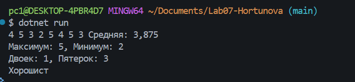
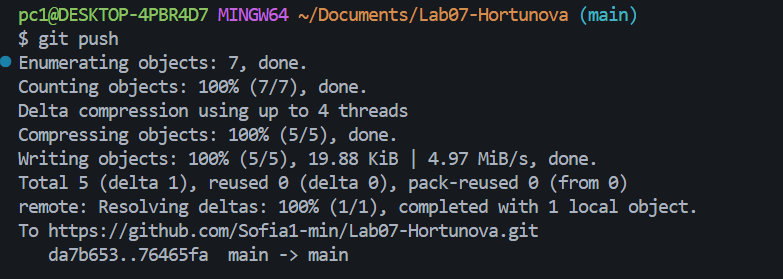

# Практическая работа №7

**ФИО:**  Хортюнова София Юрьевна
**Группа:** ИСП-241
**Дата:** 10.10.2026

## Что изучено

- Индексация массивов начинается с нуля, поэтому первый элемент имеет индекс 0, а последний — длина минус один.
- Цикл `for` нужен, когда важен индекс элемента (например, для изменения значений по порядку или обмена элементов), а `foreach` — когда нужно просто перебрать все элементы по очереди.
- Как решать типовые задачи с массивами: находить сумму и среднее, искать минимум и максимум, а также считать количество элементов по условию.

---
